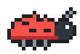
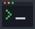

<h2>Hi there, I'm Dhandy Joenathan </h2>

<p><em>
   Quality Engineer / SDET, hunting bugs with web UI & API test automation
  <br />
   Vibe coding with AI: automation, AI agents & MCP servers for QA
  <br />
   Based in Salatiga, Indonesia
</em></p>

<a href="https://dhandyjoe.github.io"></a>
<a href="https://github.com/dhandyjoe"></a>

<br clear="all" />


###  A little more about me

```typescript
const dhandy = {
  role: "Quality Engineer / SDET",
  testing: ["Cypress", "Robot Framework", "Selenium"],
  api: ["Postman", "Jest"],
  code: ["TypeScript", "JavaScript", "Kotlin", "Java"],
  tools: ["React", "Node.js", "Vite", "Firebase"],
  ai: ["vibe coding", "AI agents", "MCP servers"],
  focus: "building tools that make QA faster",
};
```

<br clear="all" />

###  Things I've built

| Project | Description | Stack |
| :-- | :-- | :-- |
| [**Casebook**](https://github.com/dhandyjoe/casebook) | Simple test case management: write test cases, run test runs with evidence, and export PDF reports.<br /> | React · TypeScript · Firebase |
| [**Ravenhold Survivor**](https://github.com/dhandyjoe/ravenhold-survivor) | Browser survival game where every graphic is drawn in code. [▶ Play](https://dhandyjoe.github.io/ravenhold-survivor/)<br /> | Phaser · TypeScript · Vite |
| [**POC Cypress**](https://github.com/dhandyjoe/POC-Cypress-KP) | Proof of concept for end-to-end web testing. | Cypress · JavaScript |
| [**POC Robot Framework**](https://github.com/dhandyjoe/POC-Robotframework-Selenium-KP) | Proof of concept for keyword-driven UI automation. | Robot Framework · Selenium |

###  Let's connect

<em><b>I love connecting with different people,</b> so if you want to say <b>hi</b>, I'd be happy to meet you!</em>

<a href="https://www.linkedin.com/in/dhandyjoenathan/"></a>
<a href="https://www.instagram.com/dhandyjoenathan/"></a>
<a href="https://dhandyjoe.github.io"></a>

<details>
<summary>GitHub stats</summary>
<br />
<picture>
  <source media="(prefers-color-scheme: dark)" srcset="./profile/stats-dark.svg" />
  
</picture>
<picture>
  <source media="(prefers-color-scheme: dark)" srcset="./profile/top-langs-dark.svg" />
  
</picture>
</details>

<picture>
  <source media="(prefers-color-scheme: dark)" srcset="./profile/snake-dark.svg" />
  
</picture>
